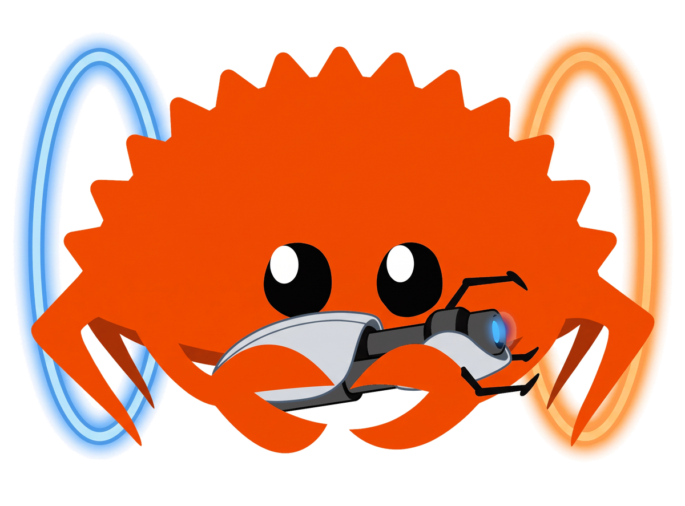
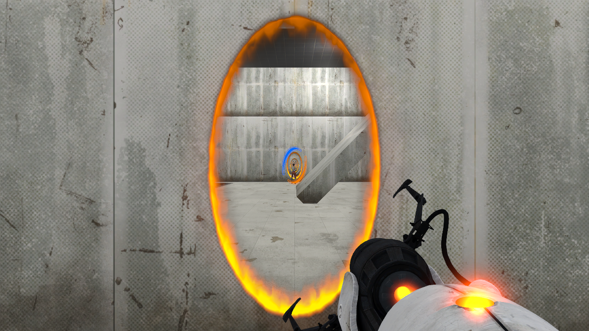
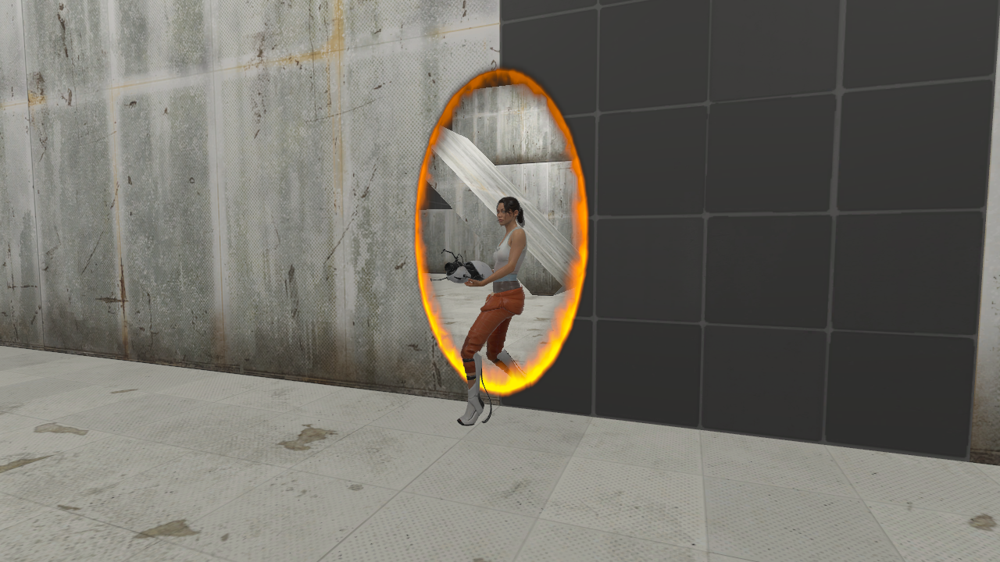

<p align="center">
  
</p>

# Portal 2 Rust Engine

**[Portal 2](https://store.steampowered.com/app/620/Portal_2/)'s portals, portal gun and first-person player, rebuilt
in Rust for [Bevy](https://bevyengine.org).** Drop one plugin group into your own Bevy game and get portals that
look, sound and behave like Portal 2's: the same placement rules, the same movement numbers, views through portals
with recursion, Chell seen through the portals as you walk through them, and Portal 2's own particles and sounds.

<p align="center">
  <a href="https://github.com/Stink-O/Portal2-rust-engine/releases/latest"><b>Download the demo (Linux, Windows)</b></a>
  &nbsp;·&nbsp;
  <a href="#use-it-in-your-own-game"><b>Use it in your own game</b></a>
</p>

<p align="center">
  <a href="https://github.com/Stink-O/Portal2-rust-engine/releases/latest"></a>
  <a href="https://bevyengine.org"></a>
  <a href="https://github.com/Jondolf/avian"></a>
  <a href="https://store.steampowered.com/app/620/Portal_2/"></a>
  <a href="LICENSE"></a>
</p>

<p align="center">
  
</p>

> [!IMPORTANT]
> **You must own Portal 2.** Buy it on [Steam](https://store.steampowered.com/app/620/Portal_2/) and install it. The
> crates read your own copy for every model, texture, particle system and sound, and nothing from the game is in this
> repository or the release downloads. Without the game, the demo and any game built on these crates refuse to start.

The behaviour (placement, transit, movement, rendering, effects and sound rules) was worked out from the game itself
and checked against it number by number. It is written in Rust from those notes, with no Valve code.

> [!WARNING]
> **Early and experimental.** This is a first release, developed and tested on one Linux PC (Fedora, NVIDIA).
>
> - **Windows is barely tested and macOS not at all.** The Windows build has only been run under Wine on Linux.
> - **One portal pair at a time** (single player). Co-op style multiple pairs are not drawn.
> - **Only the player goes through portals.** Cubes and other props are pushed around but do not travel through.
> - Collision uses [avian3d](https://github.com/Jondolf/avian) 0.7. Games with their own collision need an adapter;
>   see [Known gaps](#known-gaps).

**Contents:** [Features](#features) ·
[New in 0.1.0](#new-in-010) ·
[Getting started](#getting-started) ·
[Controls](#controls) ·
[Use it in your own game](#use-it-in-your-own-game) ·
[Building it in with an AI agent](#building-it-in-with-an-ai-agent) ·
[What's inside](#whats-inside) ·
[Known gaps](#known-gaps) ·
[Troubleshooting](#if-something-goes-wrong) ·
[Credits](#credits-and-licence)

## Features

- **Portal 2's portal gun.**
  - **Placement:** shots slide a portal off edges and corners onto the surface, the way the game fits them. Shots
    that can't fit fizzle with the right effect and sound.
  - **Shot timing:** the projectile flies in 0.1 s, with the gun's fire animation, view kick and muzzle flash.
- **Walking, jumping and falling through portals.**
  - **Timing and speed:** you teleport when the middle of your body crosses, with Portal 2's exit speed rules.
    Flings come out at the right speed.
  - **Floor and ceiling portals:** they make you crouch for a moment, as in the game.
  - **The wall behind a portal:** you can walk into the wall behind an open portal and out the other side.
- **The first-person player, with Source's numbers.**
  - **Movement:** 175 u/s walking, a 45 u jump, 18 u steps, and crouch timings.
  - **Feel:** air control, and the view levelling out after a portal turns you.
  - **Props:** you push them by walking into them.
- **Views through portals.**
  - **Recursion:** two levels deep by default, with Portal 2's depth trick filling the innermost opening, so facing
    portals make an endless tunnel.
  - **The portal surface:** the opening animation, static on a lone portal, and the burning rim and refraction,
    ported from Portal 2's own shader.
- **Chell, seen through the portals.**
  - **Animation:** the real Portal 2 model idles, runs, crouches, jumps and aims, holding the gun in both hands.
  - **Halfway through a portal:** you see her whole, half on each side, with no seam. The copy coming out of the far
    portal follows the game's own drawing rules.
- **The first-person portal gun.** The real viewmodel and its animations, the top light in the colour of your last
  shot, and Portal 2's crosshair, which shows which portals are placed.
- **Portal 2's own effects and sounds.**
  - **Particles:** rim flames, open and close bursts, fizzles, the projectile stream and the screen-warp flash when a
    portal closes.
  - **Sounds:** portal open, close and fizzle, the hum, entering and leaving a portal, footsteps per surface, jump
    and landing thuds, wall and ceiling slams, and falling wind.
- **Finds the game by itself.** It searches every Steam library on the machine (native and Flatpak Steam on Linux,
  the default Steam folders on Windows and macOS). You can also point it at the game with `PORTAL2_DIR`.
- **Modular.** One `PortalPlugins` group, or pick the plugins you want and replace the rest with your own (your own
  camera, controller or body model).

<p align="center">
  
</p>

## New in 0.1.0

The first release: the portals, portal gun, player and effects above, and a demo test chamber to try them in.

## Getting started

You need **your own copy of Portal 2, installed through Steam**, and a GPU with Vulkan (or the platform's equivalent). The demo is a
small test chamber: a room with portalable white walls, a pit, a ledge, an angled panel, a clean white side room and
a cube.

> [!TIP]
> **Just want to try it?** From the [latest release](https://github.com/Stink-O/Portal2-rust-engine/releases/latest),
> download `portal2-demo-linux-x86_64-v0.1.0.zip` and run `./portal2-demo`, or on Windows download
> `portal2-demo-windows-x86_64-v0.1.0.zip` and run `portal2-demo.exe`. It finds Portal 2 by itself. If it can't, it tells you so and you can set
> `PORTAL2_DIR` (below).

<details>
<summary><b>Build it from source</b></summary>

Install [Rust](https://rustup.rs) (stable), then:

```sh
git clone https://github.com/Stink-O/Portal2-rust-engine
cd Portal2-rust-engine
cargo run --release -p p2_app
```

The first build takes a while (Bevy is large); later builds are quick. On Linux, Bevy needs the usual packages:
see [Bevy's Linux dependencies](https://github.com/bevyengine/bevy/blob/main/docs/linux_dependencies.md).
</details>

<details>
<summary><b>If Portal 2 is somewhere unusual</b></summary>

Set `PORTAL2_DIR` to the folder that contains `portal2/` (the one with `portal2/pak01_dir.vpk` inside):

```sh
PORTAL2_DIR="/path/to/steamapps/common/Portal 2" ./portal2-demo
```
</details>

<details>
<summary><b>Scripted demo run</b></summary>

`./portal2-demo --demo <folder>` shoots both portals, walks through one, looks back and saves screenshots into
`<folder>`. It is handy for checking a build on a new machine.
</details>

## Controls

| key | action |
|---|---|
| click the window | grab the mouse (Esc releases it) |
| mouse | look |
| W A S D | move |
| Space | jump |
| Ctrl | crouch |
| left click | fire the blue portal |
| right click | fire the orange portal |

## Use it in your own game

Add the crates as git dependencies:

```toml
[dependencies]
bevy = "0.19"
avian3d = "0.7"
p2_portals = { git = "https://github.com/Stink-O/Portal2-rust-engine" }
```

```rust
use avian3d::prelude::*;
use bevy::prelude::*;
use p2_portals::core::{spawn_player, P2Settings, Portalable};

fn main() -> AppExit {
    App::new()
        .add_plugins((DefaultPlugins, PhysicsPlugins::default()))
        // Optional: Portal 2's exact 60 Hz tick (otherwise your fixed rate is kept).
        .insert_resource(P2Settings { set_fixed_timestep: true })
        .add_plugins(p2_portals::PortalPlugins)
        .add_systems(Startup, setup)
        .run()
}

fn setup(mut commands: Commands) {
    // Any static collider tagged `Portalable` takes portals; others fizzle shots.
    commands.spawn((RigidBody::Static, Collider::cuboid(20.0, 0.5, 20.0), Portalable, Transform::default()));
    // The player: feet position, yaw. Camera, viewmodel, crosshair and body come with it.
    spawn_player(&mut commands, Vec3::new(0.0, 0.5, 0.0), 0.0);
}
```

Add `PortalPlugins` after `DefaultPlugins`. Without Portal 2 installed, the app logs why and exits with an error
before opening a window. Every plugin in the group can be turned off and replaced with your own; the table in
[`crates/p2_portals/README.md`](crates/p2_portals/README.md) says what each one does and what to provide instead.
Each crate's README documents its public API and its own known gaps.

## Building it in with an AI agent

If you use a coding agent (Claude Code, Codex, Cursor and the like), you can paste the message below into it from
your game's project folder. Fill in the two lines in brackets first.

````text
Add Portal 2's portals, portal gun and first-person player to this Bevy game using the
Portal 2 Rust Engine crates: https://github.com/Stink-O/Portal2-rust-engine

My game: [what it is, and which Bevy and physics crates it uses]
What I want: [e.g. "portals on the white walls of my test level, with my own camera kept"]

Before writing code, read these from the repository:
- README.md (this file), especially "Use it in your own game" and "Known gaps"
- crates/p2_portals/README.md: the plugin group, and what to provide when replacing a plugin
- the README of any other crate you touch (crates/p2_*/README.md)

Facts to rely on:
- The player must own Portal 2 and have it installed. The crates load every model,
  texture, particle system and sound from that install and ship none of them. Do not add
  placeholder assets, download game files, or work around the check. Without the game,
  AssetsPlugin logs "Portal 2 is required" and exits the app; that is intended. It finds
  the game in Steam libraries by itself, and PORTAL2_DIR overrides it.
- Versions: Bevy 0.19 and avian3d 0.7. If my game uses a different Bevy version, stop and
  tell me rather than upgrading or downgrading either side. If it uses a physics engine
  other than avian3d, stop and tell me: collision queries currently need avian3d.
- Add the dependency as p2_portals = { git = "https://github.com/Stink-O/Portal2-rust-engine" }.
  Add PortalPlugins after DefaultPlugins and PhysicsPlugins.
- World units are metres. One Source unit is 0.0254 m (p2_portals::core::U); Portal 2's
  numbers in the docs are in Source units.
- Surfaces take portals only if they are static avian colliders tagged Portalable. Every
  other surface fizzles the shot. A portal is 64 x 112 Source units (about 1.63 m x 2.84 m) and needs a flat
  area that size.
- spawn_player(&mut commands, feet_position, yaw) spawns the player with camera, gun
  viewmodel, crosshair and Chell's body. Spawn only one.
- To keep my own camera, controller or input, disable the matching plugin with
  PortalPlugins.build().disable::<...>() and do what crates/p2_portals/README.md says to
  provide instead (for example tag my camera MainCamera, or write MoveInput and ViewAngles).
- Only the player goes through portals, and only one portal pair is drawn. Don't try to
  fix these inside the crates unless I ask.

Work in small steps: get it compiling and running with the defaults first, then make
the changes I asked for. Don't edit the crates themselves; if something can't be done
from my game's code, tell me what is missing.
````

## What's inside

| crate | what it does |
|---|---|
| [`p2_portals`](crates/p2_portals) | the plugin group, and the place to start |
| [`p2_core`](crates/p2_core) | shared types and messages: player, portals, view angles, the frame and system order |
| [`p2_assets`](crates/p2_assets) | finds and mounts Portal 2, portal textures, model animation sampling |
| [`p2_movement`](crates/p2_movement) | the Source / Portal 2 first-person controller, keyboard and mouse |
| [`p2_gun`](crates/p2_gun) | firing and placing portals |
| [`p2_transit`](crates/p2_transit) | teleporting through portals, and the wall behind an open portal |
| [`p2_render`](crates/p2_render) | views through portals, recursion and the portal surface shader |
| [`p2_view`](crates/p2_view) | the first-person camera, the gun viewmodel and the crosshair |
| [`p2_body`](crates/p2_body) | Chell, her animation, and her copy through portals |
| [`p2_fx`](crates/p2_fx) | Portal 2's particle systems and sounds |
| [`p2_room`](crates/p2_room) | the demo's test chamber |
| [`p2_app`](crates/p2_app) | the demo binary, `portal2-demo` |
| [`source_assets`](crates/source_assets) | reading Portal 2's files: VPK, VMT/VTF materials, MDL models, sound and particle data |

`shared`, `d3d9_decl`, `d3d9_sm3` and `d3d9_state` are support crates used by `source_assets`.

Code comments cite sections of the behaviour notes the crates were written from (`research/specs/*.md`). Those
notes are kept outside this repository.

## Known gaps

- **Physics engine.** Collision queries go through avian3d 0.7. Projects with their own collision, like most game
  rewrites, would need a small adapter (ray, box sweep and overlap queries). That interface is planned, not built.
- **Bevy 0.19.** Bevy 0.20 is out; moving to it is planned once avian supports it.
- **Props and portals.** Cubes can be pushed but not picked up, and they don't go through portals.
- **One portal pair.** Multiple pairs (co-op) are not drawn.
- **Chell.** She has no head look, turn-on-the-spot or foot placement, and her eyes look straight ahead.
- **Placement sparks** draw their whole sprite sheet as small squares, because the sheet layouts are not decoded yet.
- **Sounds** must be 16-bit PCM WAV, which covers every sound used here. Sounds are not panned left and right.
- **No levels.** This is a toolkit and a test chamber, not a way to play Portal 2's maps.

## If something goes wrong

- **"Portal 2 is required" and the app exits.** It could not find the game. Check that Portal 2 is installed
  through Steam, or set `PORTAL2_DIR` as shown above. The message names the folder it checked.
- **The first launch is slow or stutters for a moment.** Bevy compiles its shaders the first time they are used.
- **Black or missing textures.** The game's files could not be read. Run from a terminal and look for lines from
  `p2_assets`, `p2_fx` or `p2_room` naming the file.

Bug reports are welcome in [Issues](https://github.com/Stink-O/Portal2-rust-engine/issues).

## Credits and licence

GPL-3.0-only licensed: see [LICENSE](LICENSE). A game that ships these crates must be under a GPL-3.0-compatible licence and offer its source. (Release 0.1.0 was published under the MIT License and stays available under it.) The mascot is [Ferris](https://rustacean.net) by Karen Rustad Tölva (public
domain), with a portal gun. Third-party code and its licences are listed in [NOTICE](NOTICE): the
`d3d9_*` crates come from [IW4L](https://github.com/vladtrc/iw4L) (Apache-2.0).

An independent fan project, not affiliated with or endorsed by Valve. Portal 2 is Valve's, and you need your own
copy.
